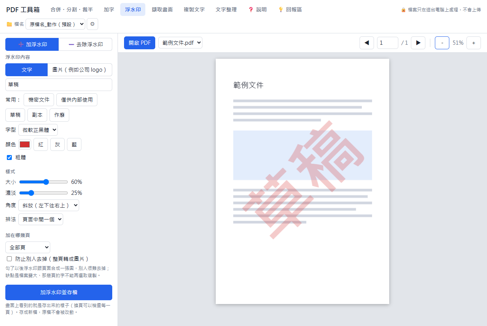

# PDF 工具箱

**免安裝、免登入、檔案不上傳**的線上 PDF 工具，專門顧好中文文件：加的字不會變方框、掃描檔也能取字。

### 👉 [打開 PDF 工具箱](https://r-toooooooooool.github.io/pdf-toolbox/)

## 能做什麼

| 分頁 | 做什麼 |
|---|---|
| 合併・分割・裁半 | 好幾個 PDF、照片、Word、Excel 排好順序合成一份（Word、Excel 會先轉成 PDF 頁面）；拆成好幾檔；掃描的「一張兩頁」裁成兩頁；旋轉、刪頁 |
| 加字 | 在 PDF 上直接打中文（正黑體、標楷體、細明體），任何電腦打開都不會亂碼；🖍 螢光筆、方框、圓圈、直線、箭頭（實線／虛線）；白底遮蓋錯字；⬛ 塗銷機密資料（真的刪掉，不是蓋住） |
| 浮水印 | 加「機密」「草稿」這類文字或公司 logo，可調大小、濃淡、角度、滿版；也能去掉 Acrobat、Word 加的浮水印 |
| 擷取畫面 | 框選一塊範圍，直接貼到 LINE、Word、Email |
| 複製文字 | 取出整頁或框選範圍的文字；掃描檔也能自動認出上面的字（繁體中文＋英文） |
| 文字整理 | 從 PDF 複製出來的字斷行亂掉、字中間有空格？貼進來一鍵整理；常打錯的字可以記起來自動改 |

另外：存檔可以自訂檔名規則（日期、序號…）、Ctrl+S 存檔、雙擊縮圖放大看。

## 擴充功能版（Chrome／Edge）

### 👉 [擴充功能介紹與下載](https://r-toooooooooool.github.io/pdf-toolbox/extension/)

功能跟網頁版一樣，另外多了：

- 正在瀏覽器裡看 PDF 時，按工具列的圖示，這份 PDF 直接送進工具箱，不用先下載
- 網頁上的 PDF 連結按右鍵 →「用 PDF 工具箱開啟」；好幾份可以一份一份加進同一個工具箱再合併
- 需要的程式都裝在裡面，沒網路也能用（掃描檔認字第一次要上網下載辨識資料）
- 有新版時，工具上方會提醒並列出新功能，**要不要更新由你決定**（按「這版先不要」就不更新；說明頁也能關掉提醒）

安裝：

1. 到[擴充功能介紹頁](https://r-toooooooooool.github.io/pdf-toolbox/extension/)按「下載擴充功能」，在下載的壓縮檔按右鍵 →「全部解壓縮」，把資料夾放在不會被刪掉的地方
2. 網址列輸入 `chrome://extensions`（Edge 是 `edge://extensions`），打開「開發人員模式」
3. 按「載入未封裝項目」（Edge 叫「載入解壓縮」），選剛剛的資料夾
4. 按網址列右邊的拼圖圖示，把 PDF 工具箱釘出來

詳細步驟在壓縮檔裡的「安裝說明.txt」。

## 怎麼用

1. 打開 [https://r-toooooooooool.github.io/pdf-toolbox/](https://r-toooooooooool.github.io/pdf-toolbox/)（建議用電腦版 Chrome 或 Edge；手機也能用基本功能）
2. 把 PDF（或照片、Word、Excel）拖進畫面，或按「加入檔案」「開啟檔案」
3. 上面選要做的事，做完按存檔（或 Ctrl+S）

每個分頁的詳細說明，在工具裡的「❓ 說明」。

## 檔案安全

- **檔案全部在你自己的瀏覽器裡處理（包括 Word、Excel 轉成 PDF），不會上傳到任何伺服器。** 關掉網頁就沒了。
- 會連上網路的只有：第一次打開時下載工具本身（有防偽檢查，被動過手腳會拒絕使用）、第一次辨識掃描檔時下載辨識資料、以及你在「回報區」主動送出的意見。擴充功能版另外會看一下有沒有新版（只讀版本號，不送出任何資料）。
- 不用帳號、不用密碼。

## 有問題或想要新功能

工具裡的「💡 回報區」可以回報問題、許願新功能，也能幫別人的許願按讚。

## English

**PDF Toolbox** is a free, no-install, no-sign-in PDF tool that runs entirely in your browser — files are never uploaded.
Merge, split and halve pages (Word, Excel and image files can be added too), add text (Chinese text never turns into boxes), highlight and draw shapes, add or remove watermarks, take snapshots, extract text (even from scans) and clean up copied text.

- 👉 [Open PDF Toolbox in English](https://r-toooooooooool.github.io/pdf-toolbox/?lang=en) — or click **EN** at the top right
- 🧩 [Chrome / Edge extension](https://r-toooooooooool.github.io/pdf-toolbox/extension/#en)

## 感謝

這個工具用到這些免費公開的程式：
[pdf.js](https://github.com/mozilla/pdf.js)（Apache-2.0）、[pdf-lib](https://github.com/Hopding/pdf-lib)（MIT）、
[JSZip](https://github.com/Stuk/jszip)（MIT）、[Tesseract.js](https://github.com/naptha/tesseract.js)（Apache-2.0）
